# tpd-port

Reimplementación no oficial, en C++17 y SDL2, del motor de un juego de puzle de Wii de 2010
(*Tetris Party Deluxe*), hecha por ingeniería inversa para poder jugarlo en **Nintendo Switch**
(homebrew) y en escritorio (macOS / Linux). El código reproduce las reglas originales (que el
juego lleva incrustadas en formato TPF2), dibuja los menús y el HUD originales (layouts NW4R
BRLYT/BRLAN, fuentes BRFNA) y sintetiza la música y los efectos a partir de las secuencias y
bancos del BRSAR original.

> **Este repositorio no contiene ningún recurso del juego.** Necesitas tu propia copia
> legalmente adquirida; un script extrae los recursos de ella en tu equipo. Lee el
> [aviso legal](#aviso-legal).

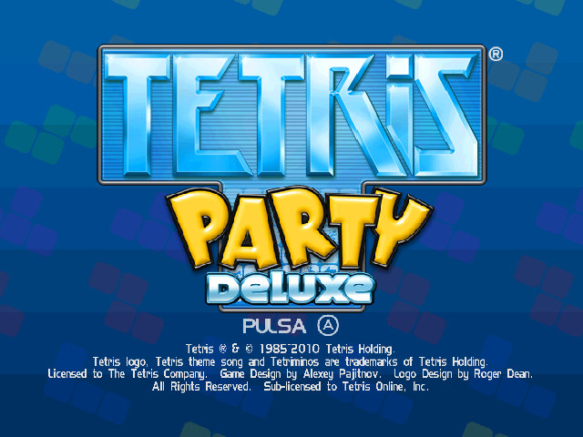

| Menú principal | Menú de un jugador | Menú multijugador |
|---|---|---|
| 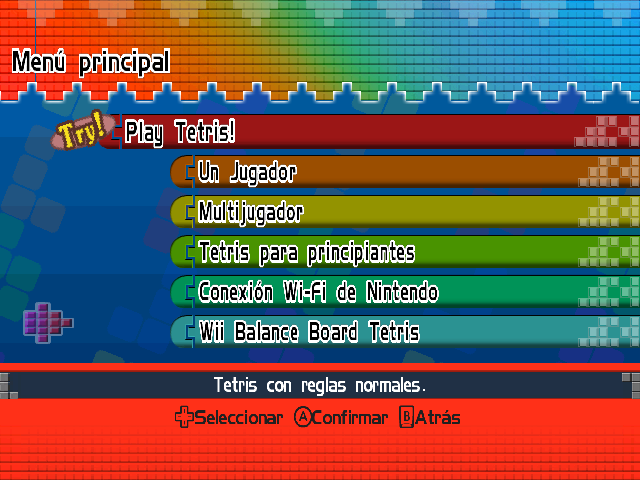 | 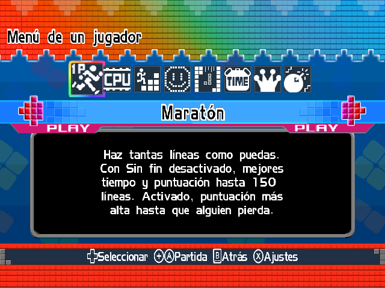 | 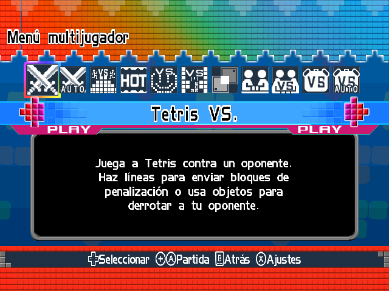 |

| Maratón | Maestro | Tetris VS a 4 |
|---|---|---|
| 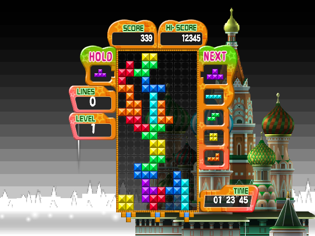 | 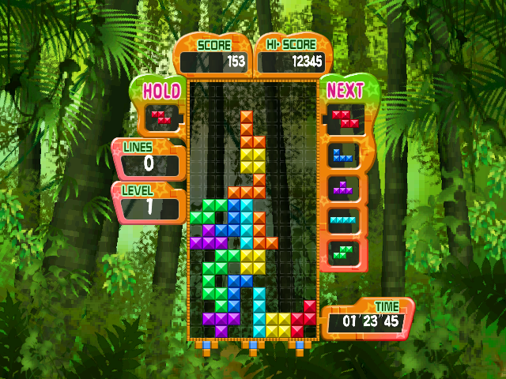 | 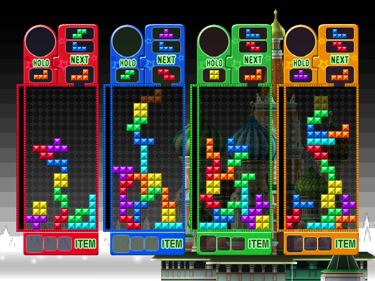 |

| Bombliss | Escalador | Corredor de etapas |
|---|---|---|
| 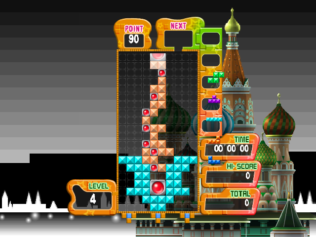 | 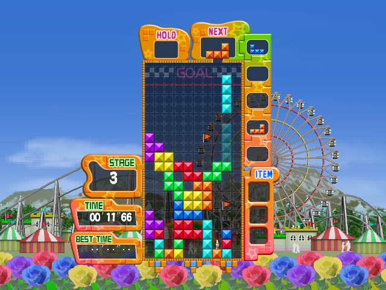 | 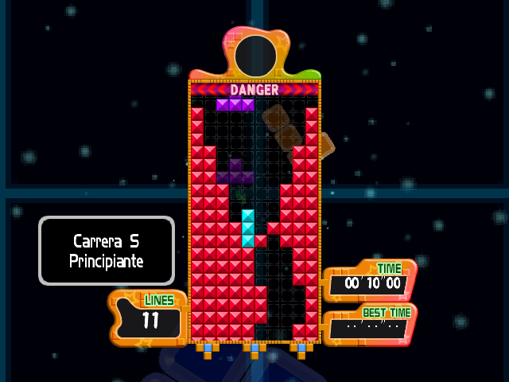 |

| Sombra | Objetos en VS | Tetris VS AUTO 5-8 (mod) |
|---|---|---|
| 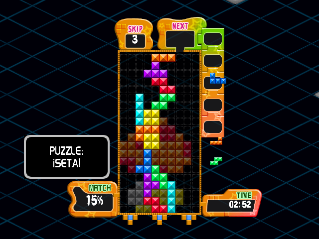 | 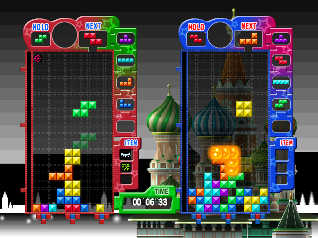 | 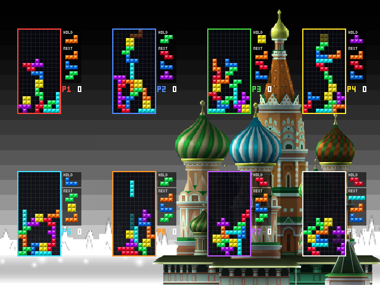 |

## Qué hay

- **Motor** (`engine/`): lector TPF2, evaluador de expresiones y ejecutor de scripts de reglas,
  RNG y bolsa de piezas idénticos al original, colisiones, kicks, DAS, lock delay, niveles,
  puntuación (spins, back-to-back, all clear, combos).
- **Modos** (`game/`): Maratón, Maestro (20G), Sprint, Principiante, Todo limpio, Escalador,
  Corredor de etapas, Bombliss, Sombra, Tetris VS (2–4 jugadores locales, equipos, handicap,
  CPU, 13 objetos) y VS contra la IA. Como añadido que no existe en el original, **Tetris VS AUTO
  5-8**: de cinco a ocho jugadores locales (un mando por humano, el resto CPU, auto-hándicap)
  con marcos dibujados por código.
- **Gráficos** (`gfx/`): U8, TPL, BRLYT, BRLAN, BRFNA, catálogo de mensajes, título, menús con
  ventana de reglas y ajustes, telops, pausa, ventana de resultados y récords.
- **Sonido** (`snd/`): lector BRSAR/RBNK/RWAV y un secuenciador + sintetizador propio para las
  secuencias RSEQ (toda la música y los efectos del juego son secuencias).
- **Herramientas** (`tools/`): extracción de recursos, capturas sin pantalla de cada modo
  (`*_snap`), simulador de reglas (`sim`), `seq2wav`.
- Pantalla de **dedicatoria** opcional al arrancar (`dedicatoria.txt`, ver
  `dedicatoria.example.txt`).

Pendiente: Mii, tutorial, editores, handicap automático, variantes VS de los modos
especiales, Wi‑Fi y Balance Board (no tienen sentido en Switch), afinado de envolventes de
sonido y de algunos detalles de los objetos.

## Cómo compilarlo

### 1. Recursos (obligatorio)

Extrae tu disco con Dolphin (clic derecho sobre el juego → *Propiedades* → *Sistema de
archivos* → *Extraer todo*). Obtendrás una carpeta `DATA` con `sys/main.dol` y `files/`.

```bash
python3 tools/extract_assets.py "/ruta/a/DATA" es
```

El segundo parámetro es el idioma de los textos (`es`, `en`, `de`, `fr`, `it`, `nl`, `uk`...).
Esto crea `assets_src/`, `data/` y `romfs/`, que `.gitignore` excluye del repositorio.

### 2. Escritorio (macOS / Linux)

```bash
brew install sdl2        # o: sudo apt install libsdl2-dev
./build_mac.sh
./tetris-mac
```

Teclado: flechas (mover / soft drop), `X` o `Intro` = A, `Z` = B, `Espacio` = X,
`A` = Y, `C`/`Mayús` = L, `V` = R, `Esc` = +. También funcionan mandos SDL (uno por jugador).

### 3. Switch, homebrew `.nro`

Con [devkitPro](https://devkitpro.org/wiki/Getting_Started) y los paquetes `switch-dev` y
`switch-sdl2`:

```bash
export DEVKITPRO=/opt/devkitpro
make
```

Copia `tetris-port.nro` y las carpetas `assets_src/` (renombrada a `assets/`) y `data/` a
`sd:/switch/tetris-port/` y lánzalo desde el Homebrew Menu. Escribe un registro en
`sd:/switch/tetris-port/log.txt`.

### 4. Switch, `.nsp` instalable

Algunos packs de CFW no permiten lanzar NRO; el NSP se instala como un título más (Tinfoil,
DBI, sphaira...). Necesitas `prod.keys` **de tu propia consola** y
[hacBrewPack](https://github.com/rlaphoenix/hacBrewPack) compilado en `tools/hacbrewpack`,
más un icono JPEG de 256×256 en `nsp/control/icon_AmericanEnglish.dat`.

```bash
./make_nsp.sh ~/.switch/prod.keys
```

El resultado queda en `nsp/out/`. Ni las claves ni el NSP deben compartirse: el NSP contiene
los recursos del juego.

## Cómo está hecho

El juego original se analizó con Ghidra (PowerPC Gekko). Las reglas de cada modo son blobs
TPF2 dentro de `main.dol` (`tools/extract_assets.py` sabe dónde están); las tablas de los
modos especiales (siluetas de Sombra, fases de Bombliss, etapas del Escalador y del
Corredor) también salen del ejecutable. Los formatos NW4R se implementaron a partir de la
documentación pública de la comunidad y de lo observado en los ficheros.

## Aviso legal

Este proyecto es una **reimplementación no oficial**, hecha por aficionados mediante
ingeniería inversa, del motor de un juego de puzle de Wii. **No contiene ningún recurso del
juego original** (gráficos, sonido, textos ni datos de reglas): para compilarlo y usarlo
necesitas **tu propia copia legalmente adquirida** del juego, de la que las herramientas
incluidas extraen los recursos en tu equipo. No se distribuyen ROM, claves, NSP ni ficheros
derivados del juego, y no se da soporte para obtenerlos.

No está afiliado, patrocinado ni aprobado por Nintendo, Hudson Soft, Tetris Online, The
Tetris Company ni ningún otro titular de derechos. *Tetris* y los demás nombres y logotipos
son marcas de sus respectivos propietarios y se mencionan solo con fines descriptivos. Las
capturas de pantalla se incluyen únicamente para documentar el proyecto. Si eres titular de
derechos y crees que algo infringe tu propiedad, abre un *issue* y se retirará.

El código se distribuye bajo licencia [MIT](LICENSE), "tal cual" y sin garantía; su uso es
bajo tu responsabilidad.

---

*English:* unofficial, fan-made reimplementation of a 2010 Wii puzzle game engine for
Nintendo Switch homebrew and desktop. No game assets are included: you need your own legally
acquired copy, from which `tools/extract_assets.py` extracts them locally. Not affiliated
with Nintendo, Hudson Soft, Tetris Online or The Tetris Company. MIT licensed.
